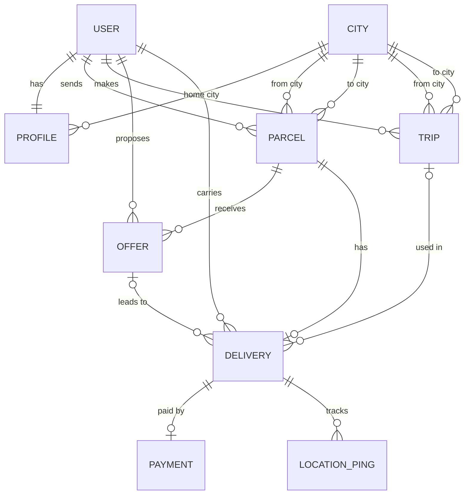

# Task Manager (Django)

## Іске қосу
```bash
python -m venv .venv
.venv\Scripts\activate
pip install -r requirements.txt
python manage.py runserver
```

## Маршруттар
- GET /health/ → {"status": "ok"}
- ## Практикалық жұмыс 2: URL, View, HTTP

Маршруттар:
- GET / → басты бет
- GET /about/ → жоба туралы
- GET /tasks/ → тапсырмалар тізімі
- GET /tasks/<id>/ → бір тапсырма (табылмаса 404)
- POST /echo/ → жіберілген JSON-ды қайтарады (қате JSON → 400)

POST тексеру (Windows PowerShell):
```powershell
Set-Content -Path "$env:TEMP\good.json" -Value '{"name": "Aibek", "age": 19}'
curl.exe -i -X POST http://127.0.0.1:8000/echo/ -H "Content-Type: application/json" --data "@$env:TEMP\good.json"
```
## Практикалық жұмыс 3: Модельдер және SQLite

Модель Task: title, description, status (todo / in_progress / done), created_at.

Командалар:
```bash
python manage.py makemigrations
python manage.py migrate
python manage.py shell
```

ORM мысалдары:
```python
Task.objects.create(title="...", status="todo")
Task.objects.filter(status="done")
Task.objects.order_by("created_at")
```
## Практикалық жұмыс 4: Django Admin

Командалар:
```bash
python manage.py createsuperuser
python manage.py runserver
```

Админ панель: http://127.0.0.1:8000/admin/

Task моделінде бағандар: title, status, created_at. Сүзгі: status. Іздеу: title.

## Практикалық жұмыс 5: Intercity Delivery жобасын жобалау

Жоба 1–4 апталарда жасалған Task Manager жобасының үстіне құрылады. `tasks` қосымшасы оқу бөлігі ретінде сақталады және жұмыс істей береді, ал негізгі жоба `delivery` қосымшасында.

### Мақсаты
Қалааралық жолдама жеткізу платформасының backend жүйесі. Жіберуші жолдаманы жариялайды, сол бағытпен баратын курьер оны алып, жеткізіп, ақы алады. Жүйе жолдама күйін, бағаны және жеткізу барысын бақылайды.

### Негізгі функциялар
1. Тіркелу және пайдаланушы профилі.
2. Жолдама жасау (қайдан, қайда, мазмұны, салмағы, мерзімі, бағасы, тапсыру тәсілі).
3. Курьердің сапарын жариялау.
4. Жолдамаларды қала, күн және баға бойынша іздеу және сүзу.
5. Жолдаманы бірден қабылдау немесе өз бағасын ұсыну.
6. Жеткізу күйін бақылау (қабылданды, алынды, жеткізілді, расталды).
7. Кепілдік төлем және қабылдаушының растауы.
8. Курьердің орналасуын бақылау.

### Сущностьтер
- **City**: name, region.
- **Profile**: user (OneToOne), phone, home_city (FK), is_verified.
- **Parcel**: sender (FK), from_city, to_city (FK), title, declared_contents, weight_kg, size, pickup_from, deliver_by, price, handover_method, pickup_fee, status.
- **Trip**: courier (FK), from_city, to_city (FK), departure_at, free_capacity_kg, transport, status.
- **Offer**: parcel (FK), courier (FK), price, status.
- **Delivery**: parcel (OneToOne), courier (FK), trip (FK), agreed_price, total_price, status.
- **Payment**: delivery (OneToOne), payer (FK), amount, status.
- **LocationPing**: delivery (FK), latitude, longitude, recorded_at.

### ER-диаграмма


### Командалар
```bash
python manage.py makemigrations delivery
python manage.py migrate
python manage.py runserver
```
Админ панель: http://127.0.0.1:8000/admin/