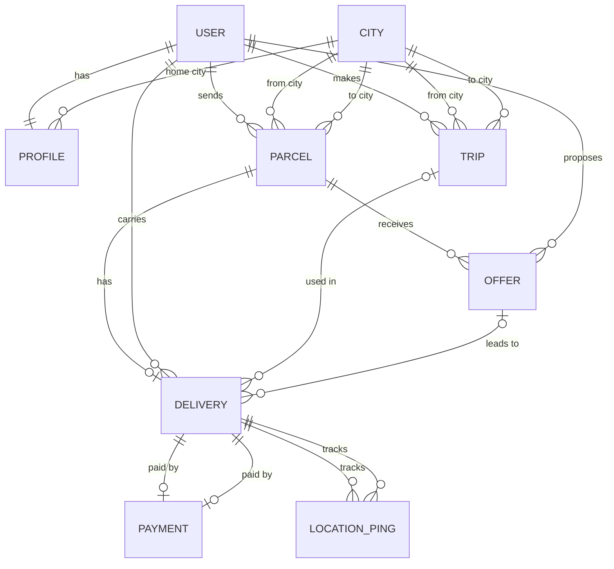

# Task Manager (Django)

## Іске қосу
```bash
python -m venv .venv
.venv\Scripts\activate
pip install -r requirements.txt
python manage.py runserver
```

## Маршруттар
- GET /health/ → {"status": "ok"}
- ## Практикалық жұмыс 2: URL, View, HTTP

Маршруттар:
- GET / → басты бет
- GET /about/ → жоба туралы
- GET /tasks/ → тапсырмалар тізімі
- GET /tasks/<id>/ → бір тапсырма (табылмаса 404)
- POST /echo/ → жіберілген JSON-ды қайтарады (қате JSON → 400)

POST тексеру (Windows PowerShell):
```powershell
Set-Content -Path "$env:TEMP\good.json" -Value '{"name": "Aibek", "age": 19}'
curl.exe -i -X POST http://127.0.0.1:8000/echo/ -H "Content-Type: application/json" --data "@$env:TEMP\good.json"
```
## Практикалық жұмыс 3: Модельдер және SQLite

Модель Task: title, description, status (todo / in_progress / done), created_at.

Командалар:
```bash
python manage.py makemigrations
python manage.py migrate
python manage.py shell
```

ORM мысалдары:
```python
Task.objects.create(title="...", status="todo")
Task.objects.filter(status="done")
Task.objects.order_by("created_at")
```
## Практикалық жұмыс 4: Django Admin

Командалар:
```bash
python manage.py createsuperuser
python manage.py runserver
```

Админ панель: http://127.0.0.1:8000/admin/

Task моделінде бағандар: title, status, created_at. Сүзгі: status. Іздеу: title.

## Практикалық жұмыс 5: Intercity Delivery жобасын жобалау

Жоба 1–4 апталарда жасалған Task Manager жобасының үстіне құрылады. `tasks` қосымшасы оқу бөлігі ретінде сақталады және жұмыс істей береді, ал негізгі жоба `delivery` қосымшасында.

### Мақсаты
Қалааралық жолдама жеткізу платформасының backend жүйесі. Жіберуші жолдаманы жариялайды, сол бағытпен баратын курьер оны алып, жеткізіп, ақы алады. Жүйе жолдама күйін, бағаны және жеткізу барысын бақылайды.

### Негізгі функциялар
1. Тіркелу және пайдаланушы профилі.
2. Жолдама жасау (қайдан, қайда, мазмұны, салмағы, мерзімі, бағасы, тапсыру тәсілі).
3. Курьердің сапарын жариялау.
4. Жолдамаларды қала, күн және баға бойынша іздеу және сүзу.
5. Жолдаманы бірден қабылдау немесе өз бағасын ұсыну.
6. Жеткізу күйін бақылау (қабылданды, алынды, жеткізілді, расталды).
7. Кепілдік төлем және қабылдаушының растауы.
8. Курьердің орналасуын бақылау.

### Сущностьтер
- **City**: name, region.
- **Profile**: user (OneToOne), phone, home_city (FK), is_verified.
- **Parcel**: sender (FK), from_city, to_city (FK), title, declared_contents, weight_kg, size, pickup_from, deliver_by, price, handover_method, pickup_fee, status.
- **Trip**: courier (FK), from_city, to_city (FK), departure_at, free_capacity_kg, transport, status.
- **Offer**: parcel (FK), courier (FK), price, status.
- **Delivery**: parcel (OneToOne), courier (FK), trip (FK), agreed_price, total_price, status.
- **Payment**: delivery (OneToOne), payer (FK), amount, status.
- **LocationPing**: delivery (FK), latitude, longitude, recorded_at.

### ER-диаграмма


### Командалар
```bash
python manage.py makemigrations delivery
python manage.py migrate
python manage.py runserver
```
Админ панель: http://127.0.0.1:8000/admin/

## Практикалық жұмыс 6: REST API және CRUD

`Parcel` (жолдама) сущносы үшін Django view арқылы CRUD API жасалды (`JsonResponse`, DRF 7-аптада қосылады).

| Әдіс | Маршрут | Сипаттама | Сәтті жауап | Қате |
| --- | --- | --- | --- | --- |
| GET | `/api/parcels/` | жолдамалар тізімі | 200 | |
| POST | `/api/parcels/` | жолдама жасау | 201 | 400 |
| GET | `/api/parcels/<id>/` | бір жолдама | 200 | 404 |
| PUT | `/api/parcels/<id>/` | толық жаңарту | 200 | 400, 404 |
| DELETE | `/api/parcels/<id>/` | өшіру | 204 | 404 |

Міндетті өрістер: `sender`, `from_city`, `to_city`, `title`, `declared_contents`, `weight_kg`, `pickup_from`, `deliver_by`, `price`, `is_declaration_confirmed`. Қосымша: `size`, `allow_offers`, `handover_method`, `pickup_address`, `pickup_fee`.

`sender` әзірге денеде беріледі, аутентификация қосылғанда (11-апта) ол токеннен алынады.

POST денесінің мысалы:
```json
{
  "sender": 2, "from_city": 1, "to_city": 2,
  "title": "Gift box", "declared_contents": "A small gift",
  "weight_kg": 1.5, "pickup_from": "2026-12-01T10:00:00+05:00",
  "deliver_by": "2026-12-04T18:00:00+05:00",
  "price": 4000, "is_declaration_confirmed": true
}
```

HTTP статустары: 200 (сәтті), 201 (жасалды), 204 (өшірілді), 400 (қате деректер), 404 (табылмады), 405 (әдіске рұқсат жоқ).

CSRF: API маршруттары `@csrf_exempt` арқылы босатылған, себебі кейін аутентификация токенмен (JWT) жүреді, ал CSRF қорғанысы cookie негізіндегі сеанстарға керек. Жобаның қалған бөліктерінде (Admin) `CsrfViewMiddleware` қосулы тұр.

## Практикалық жұмыс 7: Django REST Framework

API Django REST Framework-ке көшірілді. Маршруттар өзгерген жоқ, бірақ `JsonResponse` орнына сериализатор мен DRF generic view қолданылады.

- `ParcelSerializer` (`delivery/serializers.py`): `ModelSerializer`, `Parcel` үшін. Өрістер типі мен міндеттілігі модельден алынады.
- `ParcelListCreateView`: `GET` және `POST` `/api/parcels/`.
- `ParcelDetailView`: `GET`, `PUT`, `PATCH`, `DELETE` `/api/parcels/<id>/`.

| Әдіс | Маршрут | Сипаттама | Сәтті жауап | Қате |
| --- | --- | --- | --- | --- |
| GET | `/api/parcels/` | жолдамалар тізімі | 200 | |
| POST | `/api/parcels/` | жолдама жасау | 201 | 400 |
| GET | `/api/parcels/<id>/` | бір жолдама | 200 | 404 |
| PUT | `/api/parcels/<id>/` | толық жаңарту | 200 | 400, 404 |
| PATCH | `/api/parcels/<id>/` | жартылай жаңарту | 200 | 400, 404 |
| DELETE | `/api/parcels/<id>/` | өшіру | 204 | 404 |

Тексерулер: міндетті өрістер, `weight_kg > 0`, `price > 0`, `size` және `handover_method` мәндері, ондық сандардың өлшемі. `status` пен `created_at` тек оқуға арналған (клиент өзгерте алмайды).

Қателер форматы: `{"өріс": ["хабарлама"]}`. Табылмаса: `404`, `{"detail": "..."}`.

DRF Browsable API: серверді қосып, браузерде `http://127.0.0.1:8000/api/parcels/` ашыңыз.

Орнату:
```bash
pip install -r requirements.txt
python manage.py runserver

## Практикалық жұмыс 8: Байланысты модельдер және API кеңейту

Жобада 9 модель бар, олар `ForeignKey` және `OneToOne` арқылы байланысқан (ER-диаграмма жоғарыда). Бұл аптада `City`, `Trip` және жаңа `TripStop` (курьер маршрутындағы жол бойы қалалар) үшін API жасалды.

| Әдіс | Маршрут | Сипаттама | Сәтті жауап | Қате |
| --- | --- | --- | --- | --- |
| GET | `/api/cities/` | қалалар тізімі | 200 | |
| GET | `/api/cities/<id>/parcels/` | қаладан шығатын сәлемдемелер | 200 | 404 |
| GET, POST | `/api/trips/` | сапарлар тізімі, сапар жасау | 200, 201 | 400 |
| GET, PUT, PATCH, DELETE | `/api/trips/<id>/` | бір сапар | 200, 204 | 400, 404 |
| GET, POST | `/api/trips/<id>/stops/` | сапардың жол бойы қалалары | 200, 201 | 400, 404 |

Байланысты деректер жауапта көрінеді: сәлемдемеде `sender_username`, `from_city_name`, `to_city_name`; сапарда `courier_username`, қала аттары және ішкі `stops` тізімі.

Жоқ id берілсе (мысалы, `"from_city": 999`), жауап `400` және `Invalid pk "999" - object does not exist.` Жоқ сапар немесе қала адресінде `404` қайтарылады.

Тексерулер: `free_capacity_kg > 0`, сапардың бастапқы және соңғы қалалары әртүрлі, аялдама нөмірі сапар ішінде бірегей, аялдама бастапқы немесе соңғы қала болмайды.
```
## Практикалық жұмыс 9: Сүзу, іздеу, сұрыптау және пагинация

`GET /api/parcels/` тізімі query-параметрлерді қабылдайды. Барлық тізімдер бетіне 5 жазбамен беріледі (`PAGE_SIZE = 5`).

| Параметр | Мысал | Сипаттама |
| --- | --- | --- |
| `from_city` | `?from_city=1` | қала id бойынша шығу қаласы |
| `to_city` | `?to_city=3` | қала id бойынша баратын қала |
| `status` | `?status=open` | күй: `open`, `assigned`, `in_transit`, `delivered`, `cancelled` |
| `size` | `?size=M` | өлшем: `S`, `M`, `L` |
| `handover_method` | `?handover_method=courier_pickup` | тапсыру тәсілі |
| `min_price`, `max_price` | `?min_price=3000&max_price=8000` | баға диапазоны |
| `max_weight` | `?max_weight=3` | салмақ шегі (кг) |
| `search` | `?search=gift` | `title` және `declared_contents` өрістерінде мәтін бойынша іздеу |
| `ordering` | `?ordering=-price` | сұрыптау: `created_at`, `price`, `pickup_from`, `deliver_by`, `weight_kg`; `-` белгісі кему ретін береді |
| `page` | `?page=2` | бет нөмірі (бетіне 5 жазба) |

Параметрлерді біріктіруге болады:
```
/api/parcels/?from_city=1&min_price=5000&ordering=-price&page=1
```

Жауап пішімі:
```json
{
  "count": 23,
  "next": "http://127.0.0.1:8000/api/parcels/?page=2",
  "previous": null,
  "results": [ ... 5 сәлемдеме ... ]
}
```

Қателер: жоқ бет `?page=99` → `404`; жоқ қала `?from_city=999` → `400`.

`GET /api/trips/` тізімі де сүзуді (`from_city`, `to_city`, `status`, `transport`) және сұрыптауды (`departure_at`, `free_capacity_kg`, `created_at`) қолдайды.

Тест деректер: `python seed_parcels.py` (20 сәлемдеме қосады, қайталап іске қосуға болады).

Орнату: `pip install -r requirements.txt` (django-filter қосылды).

## 10-практикалық жұмыс (work-10): Тіркелу және пайдаланушы деректері
- Іске асырылған endpoint-тер:
  - `POST /api/auth/register/` — жаңа пайдаланушыны тіркеу (`create_user` арқылы құпиясөзді хэштеу, `username` бірегейлігін тексеру).
  - `GET /api/auth/me/` — пайдаланушы деректерін алу.
- Postman арқылы тіркелу (`201`), қайталанған `username` қатесі (`400`), `/api/auth/me/` (`200`) және алдыңғы апталардың маршруттары тексерілді.
- Postman арқылы тіркелу (`201`), қайталанған `username` қатесі (`400`), `/api/auth/me/` (`200`) және алдыңғы апталардың маршруттары тексерілді.

## 11-практикалық жұмыс (work-11): JWT авторизация және жазу операцияларын қорғау
- SimpleJWT қосылды: `POST /api/auth/token/` және `POST /api/auth/token/refresh/`.
- Жазу операциялары (`POST`, `PUT`, `PATCH`, `DELETE`) тек токені бар пайдаланушыға рұқсат, `GET` бәріне ашық.
- Жолдама жасағанда `Parcel.sender = request.user`, `sender` өрісі денеден қабылданбайды.
- `GET /api/auth/me/` токен иесінің деректерін қайтарады.
- Postman арқылы тексерілді: токен алу, 401, жолдама жасау, refresh.
-